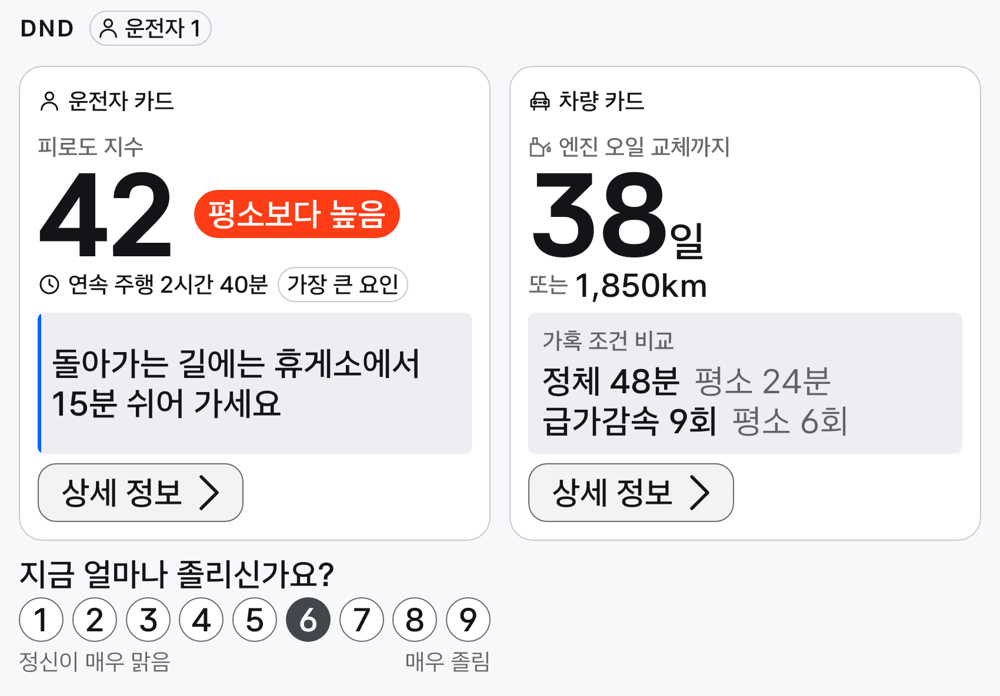
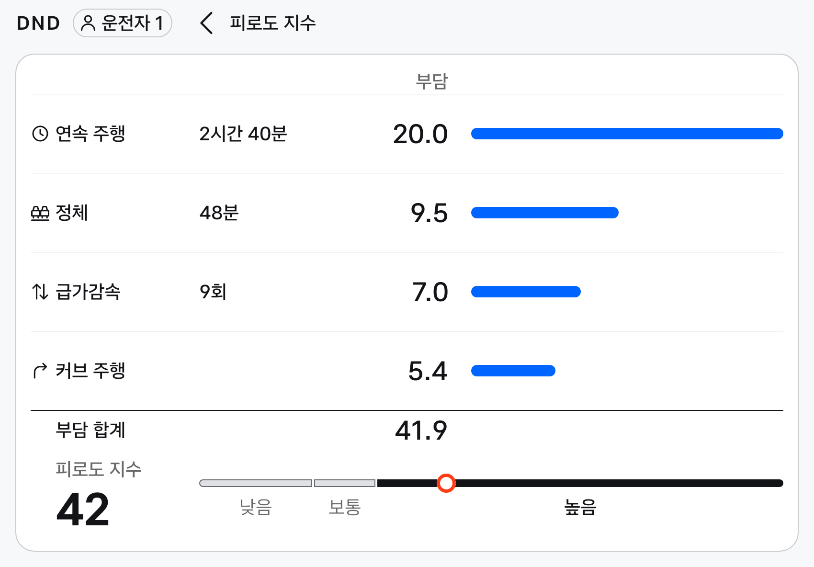
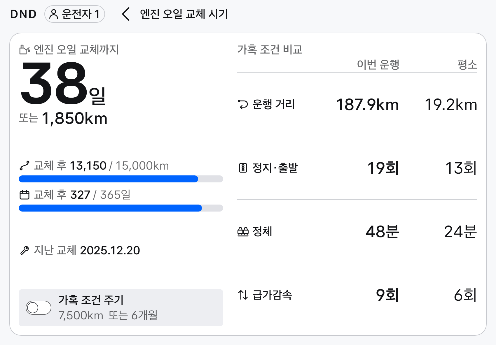
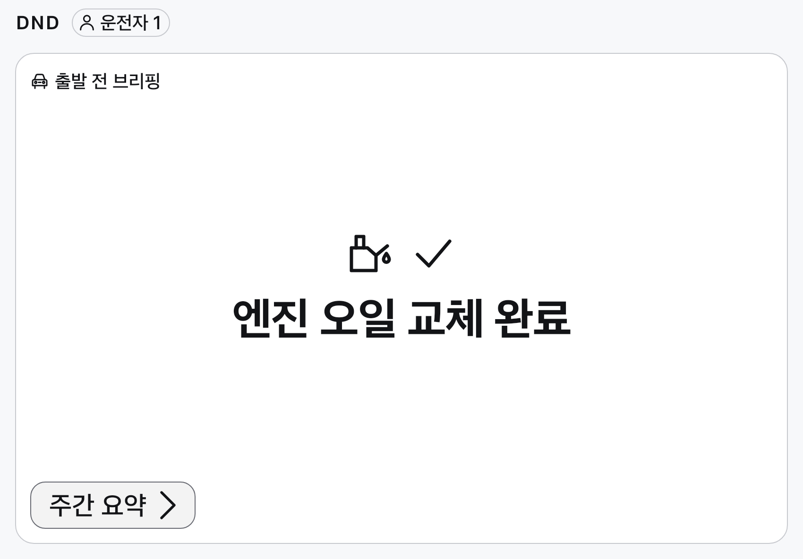
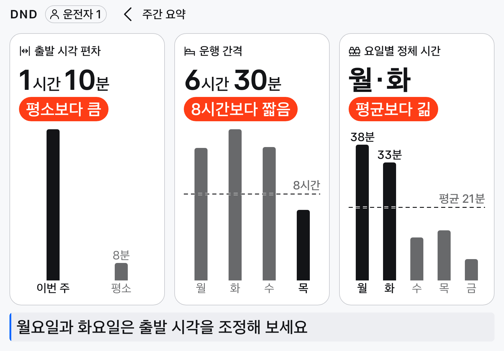

# DND (Data Never Dies)

**당신의 데이터가 당신을 돌보도록**

DND는 운행을 마칠 때마다 그 기록을 차량 카드와 운전자 카드로 가공해, 다음 정비까지 남은 거리와 기간, 운전자에게 쌓인 피로와 필요한 휴식을 알려 주는 Pleos Connect 앱입니다. 2026 현대자동차그룹 차량용 앱 개발 공모전 출품작입니다.

[시연 영상](docs/video/DND_demo.mp4) | [APK](apk/DND_DND_release.apk) | [설명서: 산식과 근거](docs/formula.md)

계산 모듈 시험 75개 통과 · 서명한 release APK · Android 14 에뮬레이터 실행 확인

운전을 마치고 차 안에서 확인할 수 있는 것은 주행거리와 시간, 평균 연비 정도입니다. 그 운전이 평소보다 거칠었는지, 차와 사람에게 어떤 부담이 쌓였는지는 알 수 없습니다. DND는 같은 운행 기록에서 피로도 지수와 다음 정비 시점을 함께 계산합니다.



대구에서 서울까지 운전하고 P단으로 바꾼 뒤의 화면입니다. 카드는 휴게소를 떠난 14:30부터 도착한 17:10까지의 운행을 다룹니다. 운전자 카드는 피로도 지수 42와 가장 큰 요인인 연속 주행 2시간 40분을, 차량 카드는 엔진 오일 교체까지 남은 38일과 1,850km를 보여 줍니다.

| 운전자 카드 상세 정보 | 차량 카드 상세 정보 |
|---|---|
|  |  |
| 지수를 만든 항목과 항목별 부담을 보여 줍니다. | 이번 운행과 평소 운행을 가혹 조건 항목별로 비교하고, 가혹 조건 주기를 켜면 교체 시기를 다시 계산합니다. |

| 출발 전 브리핑 | 주간 요약 |
|---|---|
|  |  |
| 지난 운전 뒤 달라진 것을 한 문장으로 알려 줍니다. | 한 주의 출발 시각, 운행 간격, 정체를 모아 보여 줍니다. |

## 무엇을 하는 앱인가

1. 주행 중에는 차량 신호를 기록만 하고 화면에는 아무것도 띄우지 않습니다. 안내는 연속 주행 2시간 음성 안내 하나입니다.
2. 기어가 P단으로 바뀌면 운행을 마친 것으로 보고 기록을 가공합니다. 운행을 구분하고, 지표를 계산하고, 본인의 최근 28일 운행과 비교합니다.
3. 정차 중에 두 카드를 보여 줍니다.
   - 운전자 카드: 0~100의 피로도 지수, 가장 큰 요인, 휴식 안내, 졸음 자가 체크
   - 차량 카드: 다음 엔진 오일 교체까지 남은 기간과 거리(먼저 닿는 쪽을 크게), 가혹 조건 항목별로 비교한 이번 운행의 값과 최근 28일의 평소 값, 운전자가 고르는 가혹 조건 주기
4. 두 카드의 '상세 정보'는 지수를 만든 항목과 항목별 부담, 가혹 조건 비교와 주기 선택을 보여 줍니다.

계산식과 가중치, 지표의 정의, 출처는 화면 대신 [설명서](docs/formula.md)에 있습니다. 화면의 글자 크기와 양을 정한 기준도 설명서 11절에 있습니다.

## 이 버전에 들어 있는 것

| 단계 | 이 버전 | 다음 단계 |
|---|---|---|
| 수집 | 세 가지 사용 상황의 운행 기록 재생 | AAOS Car API(속도, 기어, 외부 온도)와 Pleos Vehicle SDK(조향각, 누적 주행거리, 연료, 오일과 브레이크액 레벨, 워셔액) 수집 |
| 저장 | 메모리 | 차 안의 로컬 데이터베이스(Room) |
| 가공 | 운행 구분, 급가감속, 정지·출발, 정체, 커브 주행, 평소와 비교, 피로도 지수와 등급, 안내 문구, 정비 시점, 출발 전 브리핑, 주간 요약 | 동승자별 승차 피로, 자가 체크 응답으로 가중치 보정 |
| 표시 | 출발 전 브리핑, 운행 기록 재생, 운행 종료 화면, 상세 정보, 주간 요약 | 프로필 선택, 차종과 정비 기록 입력, 예외 화면, 음성 안내(TextToSpeech SDK) |

이 버전의 운행 기록은 세 가지 사용 상황에 맞춰 만든 합성 데이터입니다. 상황 1은 13:00~17:10의 1초 간격 신호 기록에서 처음부터 계산하고, 상황 2와 3은 28일분 운행 요약에서 계산합니다.

## 실행 방법

APK는 [apk/DND_DND_release.apk](apk/DND_DND_release.apk)입니다.

```
adb install -r apk/DND_DND_release.apk
adb shell am start -n io.github.dnddataneverdie.dnd/dnd.app.MainActivity
```

- 그대로 실행하면 상황 2의 출발 전 브리핑이 열리고, 제목 줄의 "데모" 버튼에서 상황 1, 2, 3을 고릅니다.
- 상황 1을 고르면 운행 기록을 줄여 재생합니다. 재생이 끝나면 알림의 "카드 보기"를 눌러 운행 종료 화면을 엽니다.
- 상황을 정해 실행하려면 `--es scenario s1`(또는 `s2`, `s3`)을 붙입니다. 이때 "데모" 버튼은 `--ez demo_controls true`를 함께 줄 때만 보입니다. 조작 없이 상황 1을 재생하려면 다음과 같이 실행합니다.

```
adb shell am start -n io.github.dnddataneverdie.dnd/dnd.app.MainActivity --es scenario s1 --ez autoplay true
```

## 테스트 환경

- Android 9(API 28) 이상, 가로 화면
- 개발에 쓴 에뮬레이터와 화면 규격: Android 14(API 34) 에뮬레이터, 2560×1440, 160DPI(Pleos Connect 17인치 디스플레이 규격)
- 화면은 Pleos Connect 17인치 디스플레이(2560×1440, 160DPI)의 가로 앱 창(1700×1184)에 맞춰 그렸고, 다른 크기에서는 같은 비율로 줄거나 늘어납니다. 창이 놓이는 자리는 [docs/screenshots/display_context.png](docs/screenshots/display_context.png)에 있습니다.
- GitHub Actions에서 확인한 것
  - 계산 모듈 단위 시험 75개를 Asia/Seoul과 UTC 두 시간대에서 실행
  - Compose 화면을 Robolectric과 Roborazzi로 1700×1184 이미지로 렌더링(`docs/screenshots/`)
  - release APK의 서명(v2, v3)을 apksigner로 검증
  - 서명한 release APK를 Android 14(API 34) 에뮬레이터(2560×1440, 160DPI)에 설치해 실행. 운행 기록 재생부터 운행 종료 화면과 상세 정보까지 멈춤 없이 넘어감. 화면과 녹화는 `docs/device/`

## 빌드

JDK 17과 Android SDK(compileSdk 36)가 필요합니다.

```
./gradlew :core:test                    # 계산 모듈 시험
./gradlew :app:recordRoborazziDebug     # 화면 캡처
./gradlew :app:assembleRelease          # release APK
```

release 빌드는 환경 변수 `DND_KEYSTORE_FILE`, `DND_KEYSTORE_PASSWORD`, `DND_KEY_ALIAS`로 서명 키를 받습니다. 값이 없으면 빌드가 멈춥니다. Android SDK가 없는 PC에서는 `:core` 모듈만 빌드됩니다.

## 구조

| 위치 | 내용 |
|---|---|
| `core/` | 순수 Kotlin 계산 모듈과 단위 시험 |
| `core/src/main/kotlin/dnd/core/demo/` | 세 가지 사용 상황의 데이터 |
| `app/` | Android 앱(Kotlin, Jetpack Compose)과 화면 캡처 시험 |
| `docs/formula.md` | 설명서: 지표 정의, 계산식, 상수, 출처, 화면의 글자 기준 |
| `docs/screenshots/` | 컬러 화면 캡처, 흑백 사본(`gray/`), 화면별 글자 수(`text_counts.tsv`) |
| `docs/video/` | 시연 영상 |
| `docs/device/` | 에뮬레이터에서 실행한 화면과 녹화 |
| `apk/` | release APK |

## 화면과 영상

- 색과 규격은 Pleos Connect UI 디자인 가이드의 라이트 테마 값을 따랐습니다. 빨강은 주의 표시에만, 파랑은 안내와 막대에, 초록은 켜진 스위치와 완료 표시에 씁니다.
- 누르는 것은 운전석 쪽(왼쪽 운전석 기준 왼쪽)에 두었고, 글자 크기와 양, 버튼과 항목의 이름은 설명서 11절의 기준을 따랐습니다.
- 글꼴은 Pleos Connect 시스템 글꼴인 Asta Sans입니다(SIL Open Font License, `licenses/AstaSans-OFL.txt`).
- 시연 영상은 앱의 Compose 화면을 시각 순서대로 렌더링한 장면을 이어 만들었습니다.
